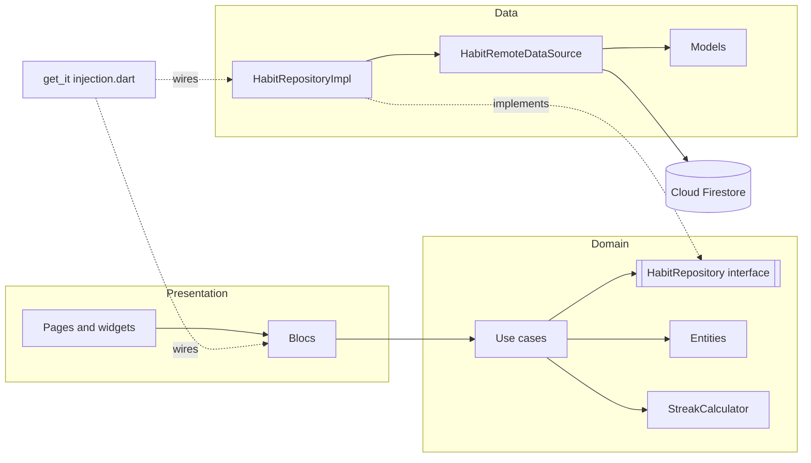
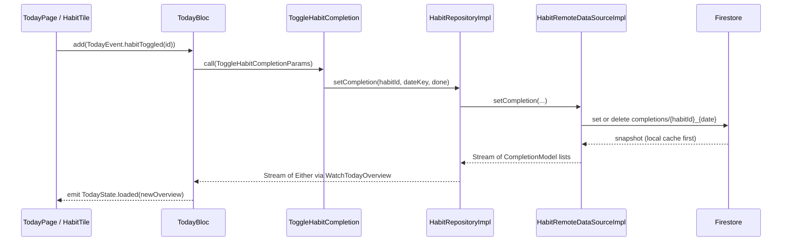

# Habitry: Code Walkthrough (Phase 2)

A speaking guide for walking an interviewer through the code, demoing the app live and sharing my screen. Everything here is taken from the actual source in `lib/` and `test/`. Where I say "the code does X", I read it in the file named next to it.

Contents

1. Project overview
2. Architecture
3. App startup flow
4. File-by-file explanation
5. Theme and design system
6. Key user flows traced through code
7. Testing
8. Setup and demo checklist
9. Likely interview questions
10. Glossary

---

## 1. Project overview

### What the app does

Habitry (the name lives in `lib/core/brand.dart` as `appName`) is a daily habit tracker. I can:

- See **Today**: a live list of habits with a done toggle, points per habit, a header showing points earned and "X of Y done", and a progress line.
- **Add a habit**: name (max 60 chars), description (max 200), points (1 to 1000).
- Open a habit's **Detail**: name, description, points, a 7-day strip (done / missed / before the habit existed), the current streak, and a button to mark today done or not done.
- **Delete** a habit by swiping its row left, then confirming in a dialog. Its completion history is deleted too.
- Loading skeleton, error with Retry, and empty states. Screen reader labels and reduced-motion support are built in.

All data comes from Firestore. There is no mock or hardcoded data. Each device signs in anonymously and only sees `users/{its uid}/...`.

### Tech stack and why each package is used (from `pubspec.yaml`)

| Package | Where it is used | Why |
| --- | --- | --- |
| `flutter_bloc` | `presentation/bloc/*`, pages | State management. Blocs turn events into states, `BlocProvider`/`BlocConsumer` connect them to widgets. |
| `bloc_concurrency` | `TodayBloc`, `HabitDetailBloc` | `restartable()` so a new "started" event cancels the old Firestore subscription. |
| `freezed_annotation` (+ `freezed`, `build_runner` as dev) | entities, models, events, states, params, `Failure` | Immutable value classes, equality, `copyWith`, and sealed unions for exhaustive `switch`. |
| `fpdart` | repository, use cases, blocs | `Either<Failure, T>` so errors are values, not thrown exceptions. `Unit` for "no value". |
| `get_it` | `lib/core/di/injection.dart` | Service locator. The only place that knows concrete classes. |
| `go_router` | `lib/core/router/*` | Declarative routes with a path parameter (`/habits/:id`). |
| `cloud_firestore` | data layer | Backend with live snapshot streams and an offline cache. |
| `firebase_core`, `firebase_auth` | `bootstrap.dart`, `core/auth` | Firebase init and anonymous sign-in so every device has private data. |
| `rxdart` | use cases, repository | `Rx.combineLatest2` (habits + completions) and `onErrorReturnWith`. |
| `cupertino_icons` | default template | Standard Flutter template dependency. |
| `bloc_test`, `mocktail`, `fake_cloud_firestore` (dev) | `test/` | Bloc tests, mocking, and an in-memory Firestore. |
| `flutter_lints` (dev) | `analysis_options.yaml` | Lint rules. |

Fonts are bundled assets (`CormorantGaramond`, `Lora`), declared in `pubspec.yaml`, so nothing is downloaded at runtime.

Note from the README: `cloud_firestore` is on the 6.x line because `fake_cloud_firestore` does not support 7.x yet.

---

## 2. Architecture

### Layers

Clean architecture with three layers. The dependency rule is `presentation -> domain <- data`.

- **domain** (`lib/features/habits/domain`): pure Dart. Entities, the `HabitRepository` interface, use cases, and `StreakCalculator`. No Flutter, no Firebase.
- **data** (`lib/features/habits/data`): Firestore data source, models (Firestore shape), and `HabitRepositoryImpl`.
- **presentation** (`lib/features/habits/presentation`): blocs, pages, widgets. Talks only to use cases.
- **core** (`lib/core`): cross-cutting pieces: DI, router, theme, errors, time, auth, usecase base classes.

The rule is enforced by a test: `test/architecture_test.dart` scans every import in `lib/` and fails on a violation.

### Folder tree with one-line purposes

```
lib/
  main.dart                      Entry point: runApp(BootstrapGate(bootstrap: bootstrap))
  app.dart                       BootstrapGate (splash / error / app) and HabitTrackerApp (MaterialApp.router)
  bootstrap.dart                 Firebase init, DI setup, anonymous sign-in, auth error messages
  bootstrap_exception.dart       Start-up error with a user-safe message
  firebase_options.dart          Firebase config (generated by flutterfire configure)
  core/
    brand.dart                   appName constant
    auth/
      user_id_provider.dart      Interface: current uid / ensureSignedIn
      firebase_user_id_provider.dart  FirebaseAuth implementation (anonymous sign-in)
    data/
      exception_mapper.dart      mapExceptionToFailure: framework exceptions -> Failure
    di/
      injection.dart             get_it registrations (composition root)
    error/
      exceptions.dart            NotFoundException, UnauthenticatedException
      failure.dart               Sealed Failure union (server, network, notFound, unauthenticated, validation, unknown)
      failure.freezed.dart       Generated
    router/
      app_router.dart            createRouter(): 3 routes, each wrapped in a BlocProvider
      app_routes.dart            Route path constants
      app_transitions.dart       buildAppPage: custom fade/slide page transitions
    theme/
      app_theme.dart             AppTheme.light(): ThemeData built from tokens
      app_tokens.dart            AppTokens ThemeExtension (colors, spacing, radii, text styles)
      app_motion.dart            Durations, curves, reduceMotion()
    time/
      clock.dart                 Clock / SystemClock (injectable "now")
      date_key.dart              DateKey: a local calendar day as yyyy-MM-dd
    usecase/
      usecase.dart               UseCase, StreamUseCase, NoParams
  features/habits/
    data/
      datasources/habit_remote_data_source.dart   Firestore reads/writes + awaitWriteAck
      models/habit_model.dart                     Firestore <-> Habit entity
      models/completion_model.dart                Firestore <-> Completion entity
      repositories/habit_repository_impl.dart     Implements HabitRepository, maps errors to Either
    domain/
      entities/                  habit, new_habit, completion, habit_streak, habit_with_status, habit_detail, today_overview
      repositories/habit_repository.dart          Contract the data layer implements
      services/streak_calculator.dart             Pure streak logic
      usecases/                  add_habit, delete_habit, toggle_habit_completion, watch_habit_detail, watch_today_overview
    presentation/
      bloc/today/                TodayBloc + events + states
      bloc/habit_detail/         HabitDetailBloc + events + states
      bloc/add_habit/            AddHabitBloc + event + states
      pages/                     today_page, habit_detail_page, add_habit_page
      utils/date_formatters.dart weekdayInitial, weekdayName, formatKicker
      widgets/                   Reusable UI pieces (listed in section 4.5)
```

Files named `*.freezed.dart` are generated by `build_runner` (see 8.2). I do not edit them; they are committed so the project builds right after cloning.

### State management

`flutter_bloc`. Each screen has one bloc, created in the router with `BlocProvider`, resolved from `get_it`:

- `TodayBloc` (events: started, habitToggled, habitDeleted, resumed)
- `HabitDetailBloc` (events: started, todayToggled, resumed)
- `AddHabitBloc` (event: submitted)

Events and states are freezed sealed classes, so the page `switch` over a state must handle every case or it will not compile.

### Persistence

Cloud Firestore, scoped by the anonymous user id:

```
users/{uid}/habits/{habitId}
  name, description, points, createdAt (Timestamp), createdDateKey ("yyyy-MM-dd")
users/{uid}/completions/{habitId}_{yyyy-MM-dd}
  habitId, dateKey ("yyyy-MM-dd"), completedAt (server timestamp)
```

`firestore.rules` allows read/write only when `request.auth.uid == uid` on `users/{uid}/**`. Firestore's local cache makes the UI work offline.

### Navigation

`go_router`, three routes (`lib/core/router/app_routes.dart`):

- `/` Today (`AppRoutes.today`)
- `/habits/new` Add habit (`AppRoutes.addHabit`), rise-up transition
- `/habits/:id` Detail (`AppRoutes.habitDetailPattern`), builds the path with `AppRoutes.habitDetail(id)`

### Diagram: layer dependencies



### Diagram: runtime data flow (live read and write)



The key idea: writes do not update the UI directly. The write changes Firestore, Firestore pushes a new snapshot into the stream the bloc is already listening to, and the bloc emits a new state. One source of truth.

---

## 3. App startup flow

Step by step, from launch to first screen:

1. **`lib/main.dart`**: `main()` calls `WidgetsFlutterBinding.ensureInitialized()` then `runApp(const BootstrapGate(bootstrap: bootstrap))`. Note it does not `await` Firebase here; that happens inside the gate so the splash can show immediately.
2. **`BootstrapGate`** (`lib/app.dart`) is a `StatefulWidget` with a private phase enum `_Phase { loading, ready, failed }`. In `initState` it calls `_run()`, which runs `widget.bootstrap` and sets the phase to `ready` or `failed`. An `_attempt` counter ignores stale results after a retry.
3. **Splash minimum**: in `didChangeDependencies` it starts a `Timer(AppMotion.splash)` (900 ms) so the intro is not cut off. If reduced motion is on (`_reduceMotion`), `_minElapsed` is true immediately.
4. **`bootstrap()`** (`lib/bootstrap.dart`):
   - If `Firebase.apps.isEmpty`, `Firebase.initializeApp(options: DefaultFirebaseOptions.currentPlatform)`.
   - `configureDependencies()` registers everything in get_it (idempotent: returns early if `UserIdProvider` is already registered, so retry is safe).
   - `getIt<UserIdProvider>().ensureSignedIn()` returns the existing user or calls `signInAnonymously()`.
   - A `FirebaseAuthException` becomes a `BootstrapException` with a readable message from `describeAuthError`.
5. **While loading** the gate shows `_BootstrapShell(child: SplashView())`. `SplashView` animates `BrandMark` (ring sweeps, check draws, 7 segments appear) and fades in the wordmark.
6. **On failure** it shows `ErrorView` ("Can't connect", kicker "OFFLINE", Retry). `_describe` uses the `BootstrapException` message, or an `UnsupportedError` message (what `firebase_options.dart` throws for an unconfigured platform), or a generic text. Retry cancels the min timer, sets `_minElapsed = true` (no extra wait) and runs `_run()` again.
7. **On success and min time elapsed** it builds `HabitTrackerApp(router: _router ??= createRouter())`, a `MaterialApp.router` with `AppTheme.light()`, `themeMode: ThemeMode.light`, the system-bar `builder`, and `routerConfig`.
8. **Router**: `initialLocation: AppRoutes.today`. The `/` route builds `BlocProvider(create: (_) => getIt<TodayBloc>()..add(const TodayEvent.started()), child: const TodayPage())`.
9. **`TodayBloc._onStarted`** emits `loading`, then `emit.forEach` over `WatchTodayOverview(NoParams())`. The first Firestore snapshot becomes `TodayState.loaded`, and `TodayPage` renders the list.
10. The switch between splash, error and app uses an `AnimatedSwitcher`. Its custom `layoutBuilder` gives the `Stack` an explicit `TextDirection.ltr`, because it sits above `MaterialApp` and there is no ambient `Directionality` (the code comment says this fixed a "No Directionality widget found" crash).

Why this design: the user never sees a blank screen, sign-in failures are recoverable without restarting the app, and `bootstrap` is passed in as a function so tests can fake it (`test/app_test.dart`).

---

## 4. File-by-file explanation

### 4.1 Root files

**`lib/main.dart`**: five lines. Binding init, then `runApp(BootstrapGate(...))`.

**`lib/app.dart`**: `BootstrapGate`, `_BootstrapGateState`, `HabitTrackerApp`, `_BootstrapShell`, and two helpers `_reduceMotion` and `_withSystemBars`.
- `_BootstrapShell` wraps the splash or error in its own `MaterialApp`, so the theme and fonts apply before the router exists.
- `_reduceMotion` uses `MediaQuery.maybeOf`, and falls back to `View.of(context).platformDispatcher.accessibilityFeatures` because the gate sits above any MediaQuery.
- `_withSystemBars` wraps in `AnnotatedRegion<SystemUiOverlayStyle>` with `AppTheme.overlayStyle()` (transparent bars, dark icons).
- The router is created once (`_router ??= createRouter()`) and disposed in `dispose()`.

**`lib/bootstrap.dart`**: `bootstrap()` and `describeAuthError()`. The error mapping turns `network-request-failed` into "No connection...", and several codes (`operation-not-allowed`, `admin-restricted-operation`, `configuration-not-found`, `internal-error`, `unknown`) into "Anonymous sign-in may not be enabled...". Anything else shows the code.

**`lib/bootstrap_exception.dart`**: `BootstrapException(message)`; the message is safe to show.

**`lib/firebase_options.dart`**: generated by `flutterfire configure`. `DefaultFirebaseOptions.currentPlatform` returns the Android or iOS options and throws `UnsupportedError` for web, macOS, Windows and Linux (not configured). `BootstrapGate._describe` shows that message on the error screen.

### 4.2 `lib/core`

**`brand.dart`**: `const String appName = 'Habitry';` single source of truth for titles, wordmark and screen reader labels.

**`auth/user_id_provider.dart`** and **`auth/firebase_user_id_provider.dart`**: an abstraction over "who is the user". The Firebase version:

```dart
Future<String> ensureSignedIn() async {
  final existing = _auth.currentUser;
  if (existing != null) return existing.uid;
  final credential = await _auth.signInAnonymously();
  ...
  return user.uid;
}
```
The data source only knows `UserIdProvider`, so tests use `FakeUserIdProvider` (in `test/helpers/fakes.dart`).

**`error/failure.dart`**: a freezed sealed union with six cases: `ServerFailure`, `NetworkFailure`, `NotFoundFailure`, `UnauthenticatedFailure`, `ValidationFailure` (message required), `UnknownFailure`. Each has a default user-facing message. Presentation just shows `failure.message`.

**`error/exceptions.dart`**: `NotFoundException`, `UnauthenticatedException`. The data source throws these; the mapper converts them.

**`data/exception_mapper.dart`**: `mapExceptionToFailure(Object)`. Examples:

```dart
if (error is FirebaseException) {
  return switch (error.code) {
    'unavailable' || 'deadline-exceeded' => const Failure.network(),
    'not-found' => const Failure.notFound(),
    'permission-denied' || 'unauthenticated' => const Failure.unauthenticated(...),
    _ => const Failure.server(),
  };
}
```
It also handles `TimeoutException` (network), `FormatException` (server, "Received unexpected data."), and falls back to `Failure.unknown()`. It sits in the data side so the domain never learns about Firebase.

**`di/injection.dart`**: `final GetIt getIt = GetIt.instance;` and `configureDependencies()`. Registration style:
- External (`FirebaseAuth`, `FirebaseFirestore`), `Clock`, `UserIdProvider`, data source, repository, use cases, and `StreakCalculator`: `registerLazySingleton`.
- Blocs: `registerFactory` (fresh instance per screen). `HabitDetailBloc` uses `registerFactoryParam<HabitDetailBloc, String, void>` so the habit id is passed in.

**`router/app_routes.dart`**: route constants and `habitDetail(id)`.

**`router/app_router.dart`**: `createRouter()`. Each route's `pageBuilder` uses `buildAppPage` and wraps the page in a `BlocProvider`. Detail pulls the id from `state.pathParameters['id']!`:

```dart
create: (_) => getIt<HabitDetailBloc>(param1: state.pathParameters['id']!)
  ..add(const HabitDetailEvent.started()),
```

**`router/app_transitions.dart`**: `AppTransitionKind { sharedAxis, riseUp }` and `buildAppPage`, returning a `CustomTransitionPage` (320 ms in, 260 ms out). The page is wrapped in `ColoredBox(color: tokens.paper)` so the page below never shows through. If `reduceMotion(context)` the page just appears.

**`theme/app_motion.dart`**: `reduceMotion(context)` (true if `disableAnimations` or `accessibleNavigation`), and `AppMotion` with durations `fast` 160 ms, `base` 240 ms, `slow` 420 ms, `splash` 900 ms, curves `standard`, `emphasized`, `spring`, and `AppMotion.of(context, duration)` which returns `Duration.zero` when motion should be reduced. Every animation in the app goes through it.

**`theme/app_tokens.dart`** and **`theme/app_theme.dart`**: see section 5.

**`time/clock.dart`**: abstract `Clock` with `now()` and `today()` (returns a `DateKey`), and `SystemClock`. Injected so tests can pin the day (`FixedClock` in `test/helpers/fakes.dart`).

**`time/date_key.dart`**: `DateKey(year, month, day)`, the calendar day as `yyyy-MM-dd`.
- `DateKey.parse` validates the format and that the date is real (rejects e.g. Feb 30).
- `minusDays` / `plusDays` go through `DateTime(year, month, day - days)`, never `Duration(days: n)`, so DST cannot shift the day.
- Implements `Comparable`, `==`, `hashCode`, `isBefore`, `isAfter`.
- Why not timestamps: streaks must not move with time zones or DST.

**`usecase/usecase.dart`**: `UseCase<Output, Params>` (returns `Future<Either<Failure, Output>>`), `StreamUseCase<Output, Params>` (returns a `Stream` of `Either`), and `NoParams`.

### 4.3 Domain layer

**Entities** (all freezed, in `domain/entities/`):
- `Habit`: id, name, description, points, `createdAt`, `createdDateKey` (a `DateKey`).
- `NewHabit`: a habit with no id yet (name, description, points, createdAt).
- `Completion`: `habitId` and `dateKey`.
- `HabitStreak` (in `habit_streak.dart`) with `DayStatus { done, missed, notApplicable }`, `StreakDay(date, status, isToday)`, and `HabitStreak(days, currentStreak)` plus getters `doneCount` and `isDoneToday` (last day is done).
- `HabitWithStatus`: `Habit`, `isDone`, `HabitStreak`. One row on Today.
- `TodayOverview`: `date` and `items`, with computed `totalCount`, `doneCount`, `totalPoints`, `earnedPoints`, and `progress` (earned / total, 0 when total is 0).
- `HabitDetail`: `Habit`, `HabitStreak`, `today`.

**`repositories/habit_repository.dart`**: the interface. Streams: `watchHabits`, `watchHabit(id)`, `watchCompletions(from, to)`. Futures: `addHabit`, `deleteHabit`, `setCompletion` (idempotent). Everything returns `Either<Failure, T>`; the interface comment says repositories never throw.

**`services/streak_calculator.dart`**: the core business logic.

```dart
HabitStreak calculate({required Habit habit, required Iterable<Completion> completions,
    required DateKey today, int windowDays = defaultWindowDays}) // 7
```
Steps:
1. Build a set of dates the habit was done (filtering `completion.habitId == habit.id`, so passing all habits' completions is safe).
2. Build `windowDays` `StreakDay`s, oldest first, ending on today.
3. Status per day: before `habit.createdDateKey` is `notApplicable`; in the done set is `done`; otherwise `missed`.
4. `_currentStreak`: start at today; if today is not done, step back one (today is still open, so it does not break the streak); then count consecutive `done` days going back.

Because it only looks inside the window, the maximum streak is 7. This is a documented limitation.

**Use cases** (`domain/usecases/`):
- `AddHabit(repository, clock)`: trims name and description, then validates (name required, name length at most 60, description at most 200, points between 1 and 1000) and returns `Left(Failure.validation(message))` without touching the repository. On success it creates `NewHabit` with `createdAt: _clock.now()`. `HabitRules` holds the limits, shared with the form validators so the numbers cannot drift.
- `ToggleHabitCompletion(repository)`: calls `setCompletion` with params `habitId`, `dateKey`, `done`. The `dateKey` is the day being displayed, not "now", so a screen left open past midnight still toggles the day it shows.
- `DeleteHabit(repository)`: rejects a blank id with a validation failure, else `deleteHabit`.
- `WatchTodayOverview(repository, clock, calculator)`: `Rx.combineLatest2(watchHabits(), watchCompletions(from: today-6, to: today), ...)`. Builds `doneIds` from completions where `dateKey == today`, then one `HabitWithStatus` per habit with its own streak. Uses `habitsResult.flatMap(... completionsResult.map(...))` so a `Left` from either stream wins.
- `WatchHabitDetail(repository, clock, calculator)`: the same pattern with `watchHabit(id)` and returns `HabitDetail`.

### 4.4 Data layer

**`datasources/habit_remote_data_source.dart`**
- Interface `HabitRemoteDataSource` and `HabitRemoteDataSourceImpl(firestore, userIdProvider, writeAckTimeout = 3s)`. Throws exceptions; the repository converts them.
- `_userDoc()` throws `UnauthenticatedException` if there is no uid, then `users/{uid}`.
- `watchHabits`: `orderBy(createdAt).snapshots()` mapped to `HabitModel`s.
- `watchHabit(id)`: throws `NotFoundException` into the stream if the doc does not exist (so a delete while on Detail is detected).
- `watchCompletions`: two `where` on `dateKey` (greater or equal `from`, less or equal `to`). A single-field range needs only the automatic index, so no composite index to deploy.
- `addHabit`: `doc()` generates the id, `HabitModel.fromNewHabit`, `doc.set`.
- `setCompletion`: deterministic doc id `habitId_yyyy-MM-dd`; `done` is `set`, not done is `delete`. No read needed and repeating it is harmless.
- `deleteHabit`: reads the habit's completions, then deletes the habit and all completions in batches of 400 (Firestore's limit is 500). The habit is in the first batch so it vanishes quickly. `_completionsOf` falls back to the cache if the server read times out (offline).
- `awaitWriteAck(write, timeout)`: `write.timeout(timeout, onTimeout: () {})`. Offline, Firestore does not complete a write future until the server acknowledges it, but the local cache already has the change. So a timeout is treated as "queued" success. Real errors (e.g. permission denied) arrive before the timeout and still surface. This is a notable design decision.

**`models/habit_model.dart`**: freezed `HabitModel`. `fromFirestore` validates field types (`name is String`, `points is num`, `createdAt is Timestamp`, `createdDateKey is String`) and throws `FormatException` if malformed; description defaults to `''`. `toFirestore`, `fromNewHabit` (computes `createdDateKey` from `createdAt`), and `toEntity` (parses the key into a `DateKey`).

**`models/completion_model.dart`**: freezed `CompletionModel(habitId, dateKey)`. `docId(habitId, dateKey)` builds the deterministic id. `toFirestore` adds `completedAt: FieldValue.serverTimestamp()` as a write-only audit field.

**`repositories/habit_repository_impl.dart`**
- `_guard(action)`: try/await, return `right(unit)`, or `left(mapExceptionToFailure(error))`.
- `_guardStream(open, map)`: maps each emission with `right(map(value))` and uses `.onErrorReturnWith` to turn a stream error into a single `Left`. If opening the stream throws synchronously, it returns `Stream.value(left(...))`. The code comment explains why it is deliberately not an `async*` generator: those only notice a cancelled subscription at the next `yield`, which would keep the Firestore listener alive.

### 4.5 Presentation layer

**Blocs** (`presentation/bloc/`). Each bloc is split into `*_bloc.dart`, `*_event.dart`, `*_state.dart` (using `part` / `part of`).

`TodayBloc`
- State: `loading`, `loaded(TodayOverview, {Failure? actionFailure})`, `failure(Failure)`.
- `on<TodayStarted>(_onStarted, transformer: restartable())`: emits `loading` only if not already `TodayLoaded` (no flicker on re-subscribe), then `emit.forEach` over the use case stream with `result.fold(TodayState.failure, TodayState.loaded)`.
- `_onToggled`: finds the item in the current overview, then calls `ToggleHabitCompletion` with `dateKey: current.overview.date` and `done: !matches.first.isDone`. On failure, `_emitActionFailure`.
- `_onDeleted`: calls `DeleteHabit`.
- `_onResumed`: if the loaded overview's date is not `_clock.today()`, add `started` again to re-subscribe for the new day.
- `_emitActionFailure`: emits `loaded(overview, actionFailure: failure)` then immediately `loaded(overview)` to clear it, so the message is delivered once (a one-shot message pattern).
- Success of a toggle or delete emits nothing: the Firestore stream does it.

`HabitDetailBloc`: same pattern. It takes `habitId` in its constructor. `_onTodayToggled` uses `done: !detail.streak.isDoneToday` and `dateKey: detail.today`.

`AddHabitBloc`: states `initial`, `submitting`, `success`, `failure(Failure)`. `_onSubmitted` ignores the event if already submitting (double-tap guard), emits `submitting`, calls `AddHabit`, then `result.fold(AddHabitState.failure, (_) => const AddHabitState.success())`.

**Pages** (`presentation/pages/`)

`TodayPage`: a `ResumeObserver` wrapping a `Scaffold`. A `BlocConsumer<TodayBloc, TodayState>`; `listenWhen` fires only when `TodayLoaded` has an `actionFailure`, then `showErrorSnackBar`. `builder` is an exhaustive `switch`: `LoadingView`, `ErrorView` (Retry adds `started`), or `_TodayList`. The persistent "New habit" button is in `bottomNavigationBar` so toasts float above it, and does `context.push(AppRoutes.addHabit)`.
`_TodayList` is a `CustomScrollView`: `ProgressHeader`, `Hairline`, then either `EmptyView('No habits yet. Begin with one.')` or a `SliverList.separated` of `HabitTile`s wrapped in `FadeSlideIn`. Callbacks: `onToggle` shows a toast and adds `habitToggled`; `onTap` pushes `AppRoutes.habitDetail(id)`; `onDelete` adds `habitDeleted`. The toast text is computed from the state before the toggle: `'${item.isDone ? '-' : '+'}${item.habit.points} points'`.

`AddHabitPage`: `StatefulWidget` that owns a `GlobalKey<FormState>` and three `TextEditingController`s (points defaults to `'10'`), all disposed in `dispose`. `_submit` runs `validate()` and, if valid, adds `AddHabitEvent.submitted(...)` with `int.parse(points)`. `BlocConsumer` listener: `AddHabitSuccess` does `context.pop()` then `showToast('Habit added')`; `AddHabitFailure` does `showErrorSnackBar`. While submitting, fields are disabled and the button shows a small progress indicator. The form is a `SingleChildScrollView` + `Column` (not a lazy list) because `Form.validate` only sees fields that are built. A custom `buildCounter` shows `n/max` only after 80% of the limit.

`HabitDetailPage`: `BlocConsumer<HabitDetailBloc, HabitDetailState>` with a `listenWhen` for failure states. If the failure is a `NotFoundFailure` (habit deleted while open) it shows a snackbar and pops. Wrapped in `ResumeObserver`. Body: `LoadingView` (detail variant), `ErrorView` or `_DetailBody`. `_DetailBody` shows kicker "HABIT", the name (header semantics), description (or "No description"), a points badge, `BaselineSplit` with "LAST 7 DAYS" and the animated streak count, `StreakRow`, and a footer "N of 7 days" / "`doneCount * points` points this week". `_TodayAction` is the bottom outlined button: "Mark today done" or "Mark today not done"; on press it fires `HapticFeedback.mediumImpact()`, shows the toast from the state before the toggle, and adds `HabitDetailEvent.todayToggled()`.

**Widgets** (`presentation/widgets/`)

| File | Class / function | Purpose |
| --- | --- | --- |
| `habit_tile.dart` | `HabitTile` | One list row: `CheckToggle`, name (strikethrough when done), `MiniStreakBar`, points. Wrapped in `Dismissible` (swipe left). `confirmDismiss` shows the dialog and always returns `false`: the row is not removed by the swipe, it disappears when the stream no longer contains the habit. A failed delete leaves the row in place. Adds a "Delete habit" custom semantics action for screen reader users. |
| `check_toggle.dart` | `CheckToggle` | 34 dp circle inside a 48 dp touch target. Gold outline plus tint plus check when done, never a solid fill. Tooltip and semantics `checked`. |
| `progress_header.dart` | `ProgressHeader` | Date kicker, "Today", earned points numeral, "/ N points", "X of Y done", and a 3 dp progress line (`TweenAnimationBuilder`, width factor clamped 0 to 1). Single combined semantics label. |
| `streak_bar.dart` | `MiniStreakBar` | 7 thin segments (gold if done) plus "N-day streak" or "No streak". Text repeats the state so colour is never the only signal. |
| `streak_row.dart` | `StreakRow` | The 7-day strip on Detail: seven `DayChip`s with staggered `FadeSlideIn`. |
| `day_chip.dart` | `DayChip`, `_Cell` | Weekday letter, status cell, day-of-month. Not-applicable days are a tiny dot. Today gets a separate gold ring (own border-only box, because a `BoxShadow` would fill a hollow cell). Semantics label like "Today, not done yet". |
| `points_picker.dart` | `PointsPicker`, `_QuickPick` | Numeric field (digits only) with minus/plus steppers (clamped to 1..1000) and quick picks 5, 10, 15, 20, 25. Validator uses `HabitRules`. |
| `app_top_bar.dart` | `AppTopBar` | Back or close button. `context.canPop() ? pop() : go(AppRoutes.today)` so deep links still work. |
| `bottom_action.dart` | `BottomAction` | Docked bottom bar with a hairline above and safe-area padding. |
| `state_views.dart` | `LoadingView` (list/detail skeletons), `ErrorView`, `EmptyView` | Skeleton shaped like the final layout (fades in once, never pulses), error with a single Retry, quiet italic empty state. |
| `toast.dart` | `showToast`, `showErrorSnackBar` | 1.4 s floating pill (e.g. "+20 points"), and a regular snackbar for failures. Each hides the current one first. |
| `confirm_delete_dialog.dart` | `confirmDeleteHabit` | `AlertDialog` "Delete habit?" returning `Future<bool>`; Delete button uses danger colour. |
| `animated_count.dart` | `AnimatedCount` | Integer that counts up or down via `TweenAnimationBuilder`; first frame shows the value directly. |
| `fade_slide_in.dart` | `FadeSlideIn` | Staggered entrance (delay `min(index, 8) * 40` ms) baked into one animation with an `Interval`, so no timers. |
| `baseline_split.dart` | `measureTextWidth`, `BaselineSplit` | Puts left and right content on one baseline; if the measured width does not fit (large text scale) it stacks them in a column. Prevents overflow. |
| `hairline.dart` | `Hairline` | 1 dp divider in the hairline colour. |
| `resume_observer.dart` | `ResumeObserver` | `WidgetsBindingObserver` that calls `onResumed` when the app returns to the foreground. Used to refresh after midnight. |
| `brand_mark.dart` | `BrandMark`, `BrandMarkPainter` | The app mark drawn with a `CustomPainter`. |
| `splash_view.dart` | `SplashView` | Branded splash with the mark and the wordmark fade-in. |

**`utils/date_formatters.dart`**: `weekdayInitial(DateKey)`, `weekdayName(DateKey)`, `formatKicker(DateKey)` (e.g. "SATURDAY · 17 OCTOBER", upper-cased). Done with plain lists rather than `intl`, so no extra dependency.

---

## 5. Theme and design system

### Idea

A light-only "classical" look: warm grey paper, near-black ink, one gold accent, two serif fonts, hairline dividers instead of cards, outlined buttons (never filled). There is only one theme: `AppTheme.light()` and `themeMode: ThemeMode.light`.

### Tokens (`lib/core/theme/app_tokens.dart`)

`AppTokens` is a `ThemeExtension<AppTokens>` (with `copyWith` and `lerp`). Read it anywhere with `context.tokens` (extension `AppTokensContext`, which falls back to `AppTokens.light` under a bare `MaterialApp`).

| Token | Value | Use |
| --- | --- | --- |
| `paper` | `0xFFF3F2F2` | Background of scaffold, dialogs, bottom bar |
| `ink` | `0xFF201F1D` | Primary text |
| `inkMuted` | `0xFF605D5D` | Secondary text |
| `inkStrong` | `0xFF2D2B2B` | Snackbar/toast and tooltip background |
| `track` | `0xFFD7D3D3` | Progress track, empty streak segments, skeleton blocks |
| `outline` | `0xFF8A8686` | Unchecked circle, input borders |
| `hairline` | `0x29201F1D` | Dividers |
| `accent` | `0xFFB68235` | Gold, strokes and bars only, never text |
| `accentTint` | `0xFFFFF3E4` | Done fill, selected picker option |
| `accentInk` | `0xFF7D5411` | Gold used for text and glyphs (accessible contrast) |
| `danger` | `0xFF9A3B2C` | Delete, errors, validation |

The doc comments in the file say muted text is at least 4.5:1 on paper, `outline` is 3:1 for non-text strokes, and `accentInk`/`danger` are at least 4.5:1. `test/core/theme/app_tokens_test.dart` has a `contrast` group that checks these.

Other token groups:
- `AppSpacing`: `s4, s8, s12, s16, s24, s32, s48` and `screenMargin = 26`.
- `AppRadii`: `control = 4` and `strip = 20` (week strip cell only).
- `AppTextTokens`: `headingFamily = 'CormorantGaramond'`, `bodyFamily = 'Lora'`. Styles: `kicker` (11, letter-spaced), `displayTitle` (46), `displayNumeral` (64), `headline` (42), `dialogTitle` (26), `streakNumeral` (48), `rowTitle` (21), `numeral` (24), `numeralSmall` (26), `emptyState` (22 italic), `body` (15), `bodySmall` (13), `caption` (12), `tiny` (10), `button` (16), `italicNote` (14 italic).
- Heading styles request `FontFeature.liningFigures()` and `tabularFigures()`. The code comment says Cormorant Garamond defaults to old-style digits, where "10" reads like "IO".

### Theme (`lib/core/theme/app_theme.dart`)

`AppTheme._build(AppTokens)` maps tokens into a Material 3 `ColorScheme.light(...)` (all surface containers set to `paper`, `surfaceTint` transparent), a `TextTheme`, and component themes: text, outlined and icon buttons (48 dp minimum, outlined button is 52 dp high with a gold border), `InputDecorationTheme` (labels always floating, `errorMaxLines: 3` so validation wraps at big text sizes), snackbar (floating, `inkStrong`), dialog, divider, tooltip, text selection, progress indicator. `extensions: [t]` registers the tokens. `AppTheme.overlayStyle()` returns transparent system bars with dark icons.

### Motion (`app_motion.dart`)

All durations come from `AppMotion`; `AppMotion.of(context, d)` returns zero when reduced motion is on.

### Brand mark (`brand_mark.dart`)

- `BrandMark(progress, width = 112, semanticLabel)` builds a `CustomPaint` with a `BrandMarkPainter`.
- The painter draws in a fixed 560 x 620 design box scaled to the canvas, matching the native launch screen so the handover lines up.
- Phases driven by `progress` (0 to 1): the ring sweeps (`drawArc`) up to 0.45, the tint fades in, the check path draws (using `computeMetrics` / `extractPath`) between 0.35 and 0.75, then seven 62 x 18 segments appear with a stagger from 0.7. Segments 0 to 3 are grey (`track`), 4 to 6 are gold, matching "four empty, three gold".
- `shouldRepaint` compares every field, so it repaints only when something changed.
- `SplashView` drives `progress` with an `AnimationController` (900 ms).

### Reusable widgets

See the widget table in 4.5. The ones I would call "design system" parts are `Hairline`, `BottomAction`, `AppTopBar`, `CheckToggle`, `FadeSlideIn`, `AnimatedCount`, `BaselineSplit`, `LoadingView`/`ErrorView`/`EmptyView`, and the toast helpers.

### Enforced by tests

`test/design_rules_test.dart` fails if the UI hard-codes a hex colour outside `app_tokens.dart`, uses filled or elevated buttons, dark themes, banned packages, the old Geist font, or dashes in copy; it also checks that the font files declared in `pubspec.yaml` exist and the OFL licences are bundled.

---

## 6. Key user flows traced through code

### 6.1 Add a habit

1. Today: user taps "New habit" (`OutlinedButton.icon` in `TodayPage.bottomNavigationBar`) -> `context.push(AppRoutes.addHabit)` -> `/habits/new`.
2. `createRouter` builds `BlocProvider(create: (_) => getIt<AddHabitBloc>(), child: AddHabitPage())`, with the `riseUp` transition.
3. User fills the form. `PointsPicker` updates the shared `_pointsController` via steppers or quick picks.
4. Tap "Save habit" (or submit on the keyboard) -> `_submit()` -> `Form.validate()`: name must be non-empty (form message "Please enter a name"), points must be a number in 1..1000.
5. `context.read<AddHabitBloc>().add(AddHabitEvent.submitted(name, description, points))`.
6. `AddHabitBloc._onSubmitted`: emits `submitting` (page disables fields, shows spinner), then calls `AddHabit(AddHabitParams(...))`.
7. `AddHabit.call`: trim, validate again (domain rules), build `NewHabit(createdAt: clock.now())`, call `repository.addHabit`.
8. `HabitRepositoryImpl.addHabit` -> `_guard` -> `HabitRemoteDataSourceImpl.addHabit`: new doc ref, `HabitModel.fromNewHabit` (adds `createdDateKey`), `doc.set(...)` with `awaitWriteAck`.
9. Result `Right(unit)` -> bloc emits `AddHabitState.success()` -> page listener: `context.pop()` and `showToast('Habit added')`. Any `Left` -> `failure` -> `showErrorSnackBar(failure.message)`.
10. Meanwhile the Today stream (still subscribed behind) receives the new habit snapshot and Today redraws with the new row.

### 6.2 Mark a habit complete (Today)

1. Tap the circle in `HabitTile` -> `CheckToggle.onPressed` -> `HapticFeedback.lightImpact()` -> `onToggle()`.
2. `_TodayList` callback: `showToast(context, '+N points')` (or `-N`), then `TodayBloc.add(TodayEvent.habitToggled(id))`.
3. `TodayBloc._onToggled`: finds the item in `TodayLoaded.overview`, calls `ToggleHabitCompletion` with `dateKey: overview.date`, `done: !item.isDone`.
4. `HabitRepositoryImpl.setCompletion` -> data source: `done` -> `set` on `completions/{habitId}_{date}`; not done -> `delete`.
5. Firestore fires a snapshot (local cache first, so it is instant even offline). `watchCompletions` emits, `WatchTodayOverview` recomputes `TodayOverview` via `combineLatest2`, `TodayBloc` emits `loaded`.
6. UI updates: `CheckToggle` animates, name gets strikethrough, `ProgressHeader` count and bar animate, `MiniStreakBar` updates.
7. If the write fails: `_emitActionFailure` emits the failure once; `TodayPage` listener replaces the toast with an error snackbar.

### 6.3 View detail

1. Tap the row (`InkWell.onTap`) -> `context.push(AppRoutes.habitDetail(item.habit.id))` -> `/habits/:id`.
2. Router creates `getIt<HabitDetailBloc>(param1: id)..add(started())`.
3. `HabitDetailBloc._onStarted` emits `loading` (skeleton), then listens to `WatchHabitDetail`, which combines `watchHabit(id)` and `watchCompletions(today-6..today)`.
4. `StreakCalculator.calculate` builds the 7 days and `currentStreak`. `HabitDetail` -> `HabitDetailState.loaded`.
5. `_DetailBody` renders; `StreakRow` shows seven `DayChip`s; the button is "Mark today done" or "Mark today not done" from `streak.isDoneToday`.
6. Tapping the button: haptic, toast, `todayToggled` -> `ToggleHabitCompletion(dateKey: detail.today, done: !isDoneToday)` -> the stream updates the streak count (`AnimatedCount`) and the chip.
7. If the habit is deleted elsewhere while open: `watchHabit` throws `NotFoundException` into the stream -> `Failure.notFound` -> `HabitDetailFailure` -> page shows a snackbar and pops.

### 6.4 Streak and progress calculation

Streak (per habit, `StreakCalculator`), with a 7-day window ending today:
- Days before the habit's `createdDateKey` are `notApplicable`.
- Streak counts consecutive `done` days going back from today. If today is not done yet, start from yesterday.

Worked example: created 10 days ago, done on days -3, -2, -1 and not today -> `currentStreak = 3`. Mark today done -> 4. Miss yesterday and today is done -> 1.

Progress (Today, `TodayOverview`):
- `totalPoints` = sum of all habit points, `earnedPoints` = sum for done habits, `progress = earned / total` (0 if total is 0).
- Example: habits worth 10, 20, 5 with only the 20 done -> earned 20, total 35, progress about 0.57, "1 of 3 done".
- Note: `totalPoints` counts every habit currently in the list. Points are not tracked historically.

### 6.5 Validation

Two layers, same limits (`HabitRules`):
- **Form (UI)**: `TextFormField` validators give instant inline errors ("Please enter a name", "Enter a number of points", "Use 1 to 1000"). `maxLength` stops typing past limits. `inputFormatters: digitsOnly` for points.
- **Domain (`AddHabit`)**: re-checks everything and returns `Failure.validation(message)`. This protects against any caller that skips the form.
- **Firestore rules**: only restrict by user id, they do not validate field values (honest limitation).
- **Data parsing**: `HabitModel.fromFirestore` and `CompletionModel.fromFirestore` throw `FormatException` on malformed docs, which becomes `Failure.server('Received unexpected data.')`.

### 6.6 Delete a habit

1. Swipe the row left -> `Dismissible.confirmDismiss` -> `confirmDeleteHabit` dialog.
2. On "Delete" -> `onDelete()` -> `TodayHabitDeleted(id)` -> `DeleteHabit` -> repository -> data source batch delete of the habit and its completions.
3. `confirmDismiss` always returns `false`; the row leaves only when the Firestore stream no longer has it.

### 6.7 Midnight and returning to the app

`ResumeObserver` calls `TodayEvent.resumed()` / `HabitDetailEvent.resumed()` on foreground. If the loaded date is not `clock.today()`, the bloc re-adds `started`, and `restartable()` cancels the old subscription and creates a new one for the new day.

---

## 7. Testing

### Run

```sh
flutter test              # everything (single run)
flutter test test/features/habits/domain/services/streak_calculator_test.dart   # one file
flutter analyze
```

The README says about 410 tests in 41 files. I have not re-counted for this document; run `flutter test` to see the live number.

### Test helpers (`test/helpers/`)

- `builders.dart`: `buildHabit`, `buildStreak`, `buildItem` for test data.
- `fakes.dart`: `FixedClock` (pinned "now") and `FakeUserIdProvider`.
- `pump_app.dart`: `themedApp(...)` (wraps a widget in the real theme) and `useSmallPhone(tester)` (small screen size).

### What each test file covers

| File | Covers |
| --- | --- |
| `test/app_test.dart` | `BootstrapGate`: Today shows after bootstrap; splash minimum time; slow bootstrap waits; error shows right away; retry flow; reduced motion; navigating to Add habit; `BootstrapException` message. |
| `test/bootstrap_test.dart` | `describeAuthError` messages per error code. |
| `test/architecture_test.dart` | Import rules across `lib/` (domain is pure; presentation does not import data/Firebase; data does not import presentation) and tests that the checker itself catches violations. |
| `test/design_rules_test.dart` | No hard-coded colours outside tokens, no filled/elevated buttons or dark themes, banned packages, fonts and licences exist, checker self-tests. |
| `test/core/auth/firebase_user_id_provider_test.dart` | Anonymous sign-in behaviour. |
| `test/core/router/app_transitions_test.dart` | Page transitions. |
| `test/core/theme/app_theme_test.dart`, `app_tokens_test.dart` | Theme wiring and colour contrast ratios. |
| `test/core/time/date_key_test.dart` | Parse/format, day arithmetic, ordering and equality. |
| `test/features/habits/data/datasources/habit_remote_data_source_test.dart` | `awaitWriteAck` (timeout and error behaviour). |
| `.../habit_remote_data_source_streams_test.dart` | Data source with `fake_cloud_firestore`: `watchHabits`, `watchHabit`, `setCompletion`, `watchCompletions`, `deleteHabit`, `CompletionModel`. |
| `.../models/habit_model_test.dart` | Model mapping and malformed data. |
| `.../repositories/habit_repository_impl_test.dart`, `habit_repository_stream_test.dart` | Exceptions become `Left(Failure)`; streams map and end on error. |
| `.../domain/services/streak_calculator_test.dart` | Window shape, statuses and streak, `isDoneToday`, input filtering, month/year/leap-day boundaries. |
| `.../domain/usecases/*_test.dart` | `AddHabit` validation (no repository call on invalid input), `DeleteHabit`, `ToggleHabitCompletion`, `WatchHabitDetail`, `WatchTodayOverview`. |
| `.../presentation/bloc/today_bloc_test.dart`, `habit_detail_bloc_test.dart`, `add_habit_bloc_test.dart` | `bloc_test`: loading then loaded, failure, toggle on/off, one-shot failure, ignoring toggles before data, restart keeps data, delete, resume. |
| `.../presentation/pages/today_page_test.dart`, `habit_detail_page_test.dart`, `add_habit_page_test.dart` | Page widget tests: states, toasts, delete flow, form validation. |
| `.../presentation/accessibility_test.dart`, `accessibility_themed_test.dart` | Semantics, touch targets, large text scale. |
| `.../presentation/utils/date_formatters_test.dart` | Date text helpers. |
| `.../presentation/widgets/*_test.dart` | `AnimatedCount`, `BrandMark` and painter, `CheckToggle`, docked widgets, `FadeSlideIn`, `PointsPicker`, `ProgressHeader`, reduced motion, state views, `MiniStreakBar`, `StreakRow`, toasts. |

### How I would explain the testing approach

- Domain logic is tested as pure Dart with fakes, which is fast.
- The data layer is tested against `fake_cloud_firestore`, so no real network.
- Blocs are tested with `bloc_test` and `mocktail`.
- Architecture and design rules are tests, not conventions, so they cannot silently rot.
- The clock is injected, so "today" is deterministic.

---

## 8. Setup and demo checklist

### 8.1 Prerequisites

Flutter 3.41+ (per README), a Firebase project with **Anonymous** sign-in enabled and a Firestore database, and the Firebase and FlutterFire CLIs.

### 8.2 Commands

```sh
cd /Users/macbook/Desktop/Assignment
flutter pub get
flutter devices                 # confirm an emulator or phone is listed
flutter run                     # or: flutter run -d <device-id>
```

Only if Firebase is not configured yet (per the README, until this is done the app shows a "Firebase is not configured" error screen with Retry):

```sh
flutterfire configure --platforms=android,ios
firebase deploy --only firestore:rules
```

`build_runner` is only needed after changing a freezed class (the generated `*.freezed.dart` files are already committed):

```sh
dart run build_runner build
```

Role of `build_runner`: it runs the `freezed` code generator, which writes `*.freezed.dart` next to each file with `part '...freezed.dart'` (entities, models, events, states, params, `Failure`). Those files contain `copyWith`, `==`, `hashCode`, `toString` and the union subclasses. I never edit them by hand.

Platform note from README: Android was built and run on a physical phone; iOS is configured but never built. Android needs a connection on first launch for anonymous sign-in.

### 8.3 Five-minute live demo script

| Time | Do | Say |
| --- | --- | --- |
| 0:00 to 0:30 | Cold start the app. | "The native splash hands over to my Flutter `SplashView`. Behind it `bootstrap()` initialises Firebase, sets up get_it and signs in anonymously." |
| 0:30 to 1:15 | Empty Today screen (or existing list). Point at header. | "Today is driven by a Firestore stream through `WatchTodayOverview`, so it updates live. This empty state is `EmptyView`." |
| 1:15 to 2:15 | Tap New habit. Submit empty first, show the validation. Then fill name "Drink 2L water", pick 15 points, Save. | "Form validators give instant feedback; `AddHabit` re-validates in the domain. Saving goes bloc, use case, repository, Firestore." Toast "Habit added". |
| 2:15 to 3:00 | Tick the habit. Show toast "+15 points", progress bar and count animating. Untick. | "Toggling writes a deterministic doc `habitId_date`. The UI changes because the stream emits, not because I mutate local state." |
| 3:00 to 4:00 | Open the detail. Show the 7 chips, today's ring, streak, footer. Tap "Mark today not done" and back. | "`StreakCalculator` is pure and builds this strip. Days before the habit existed are not counted as missed." |
| 4:00 to 4:30 | Swipe to delete, show the confirmation dialog, confirm. | "The row only disappears when the stream stops containing the habit, so a failed delete cannot lie to the user." |
| 4:30 to 5:00 | Optional: turn on airplane mode, toggle a habit, show it still updates. Then switch to the IDE on `streak_calculator.dart` or `flutter test`. | "Writes are treated as queued after 3 seconds; the cache drives the UI. Known gap: no sync indicator." |

Have two or three habits already created, with at least one done, as a fallback if the network is slow. Do not demo iOS (never built).

### 8.4 Where to be in the IDE (if asked to walk the code)

Keep these open in tabs, in this order: `lib/main.dart`, `lib/app.dart`, `lib/bootstrap.dart`, `lib/core/di/injection.dart`, `lib/core/router/app_router.dart`, `lib/features/habits/domain/services/streak_calculator.dart`, `.../usecases/watch_today_overview.dart`, `.../data/repositories/habit_repository_impl.dart`, `.../data/datasources/habit_remote_data_source.dart`, `.../bloc/today/today_bloc.dart`, `.../pages/today_page.dart`, `lib/core/theme/app_tokens.dart`.

### 8.5 Pre-call checklist

- [ ] IDE open on the project, a clean working tree, font size large enough to read when shared
- [ ] `flutter pub get` done; `flutter analyze` and `flutter test` pass
- [ ] Emulator or phone booted and listed in `flutter devices`
- [ ] App running (`flutter run`) and already past the splash once; Firebase configured, Anonymous auth enabled, rules deployed
- [ ] A few demo habits created; one done today
- [ ] Screen share tested: share the IDE and the emulator window (or the whole screen); close notifications and unrelated tabs; hide anything private (Firebase keys, other projects)
- [ ] Stable internet (use wired or strong Wi-Fi); a mobile hotspot as backup
- [ ] Microphone and camera checked in the call app; headphones in
- [ ] Charger plugged in; do-not-disturb on
- [ ] This document and `README.md` open on a second screen or printed

---

## 9. Likely interview questions with model answers

**Why clean architecture for an app this small?**
It keeps business rules (validation, streaks, progress) independent from Flutter and Firebase, so they are easy to test and to swap. Cost: more files and some mapping code. I would say it is more structure than a tiny app needs, but it shows the pattern and it paid off in tests, for example `StreakCalculator` is tested with no Flutter at all. `architecture_test.dart` keeps it honest.

**Why `flutter_bloc`, and what are the trade-offs against Provider or Riverpod?**
Bloc gives explicit events and states, which makes flows traceable and testable with `bloc_test`. `restartable()` fits the stream-subscribe pattern well. The trade-off is boilerplate (event, state, bloc files). Riverpod is less verbose, but the event log of a bloc is helpful for debugging.

**Why are events/states freezed sealed classes?**
Immutability, value equality (so `bloc_test` can compare states), and exhaustive `switch` in the pages, so adding a state makes the compiler flag every place that must handle it.

**Why `Either<Failure, T>` instead of exceptions?**
Failures become part of the type signature, so callers have to handle them. Presentation never sees Firebase exceptions; `mapExceptionToFailure` translates them in one place.

**Why does a write not update the UI directly?**
Firestore snapshot streams are the single source of truth. The write goes to the local cache first, which emits immediately, even offline. That avoids two copies of state that can disagree.

**How does the app work offline?**
Firestore's local cache serves reads and records writes. Offline, a write future does not complete until the server acknowledges it, so `awaitWriteAck` times out after 3 seconds and treats it as queued. Real errors like permission denied still arrive before the timeout. Gap: there is no "not synced" indicator.

**Why store dates as `yyyy-MM-dd` strings (`DateKey`) rather than timestamps?**
A habit's "day" is a local calendar day. Strings avoid time zone and DST problems, sort lexicographically so range queries work, and deterministic doc ids (`habitId_date`) make toggling idempotent with no read.

**Why is the completion id deterministic?**
Marking done is a `set` and undoing is a `delete`, with no read first. Doing it twice produces the same state, so double taps and retries are safe.

**How is the streak calculated and what are the edge cases?**
See 6.4. Edge cases: days before creation are not missed; today not yet done does not break the streak; the window is only 7 days, so the maximum is 7; tests cover month, year and leap-day boundaries. A limitation is that long-term streaks are not supported.

**What happens past midnight?**
`ResumeObserver` fires `resumed` when the app returns to the foreground; if the date changed the bloc re-subscribes for the new day. Toggles use the displayed date (`overview.date` / `detail.today`), not "now". A gap: if the app stays in the foreground across midnight with no lifecycle change, it does not auto-refresh.

**Performance considerations?**
The Today query only reads a 7-day completion range, not all history. Lists use slivers (`SliverList.separated`). Widgets are `const` where possible. Blocs are created per screen and closed by `BlocProvider`. Subscriptions are cancelled via `emit.forEach` and `restartable`. The repository avoids `async*` generators so the listener cancels promptly. Possible issue: `TodayOverview` recalculates all streaks on every snapshot, which is fine for tens of habits but I would measure for hundreds.

**Why `get_it` and why factories for blocs?**
get_it is a simple service locator that confines concrete classes to `injection.dart`. Blocs are factories because each screen needs its own instance; `HabitDetailBloc` uses a param factory for the habit id. The trade-off against constructor injection through the widget tree is that a service locator hides dependencies somewhat; tests avoid it by passing fakes directly.

**How do you handle errors in the UI?**
Stream errors become `*Failure` states with `ErrorView` and Retry. One-shot action errors (failed toggle or delete) are emitted on `loaded` as `actionFailure`, shown once in a snackbar, then cleared by a second emit so they are not replayed on rebuilds.

**Security?**
Anonymous auth gives each install a uid. `firestore.rules` restrict access to `users/{uid}/**` for that uid. Gaps: rules do not validate field values or sizes; anonymous accounts are lost if the app data is cleared (no account linking).

**How did you test it?**
See section 7: pure-Dart tests for domain, `fake_cloud_firestore` for data, `bloc_test` for blocs, widget tests for pages with accessibility and 2x text scale checks, plus architecture and design rule tests.

**Accessibility?**
Semantic labels (`CheckToggle`, `MiniStreakBar`, `DayChip`, progress summary), 48 dp touch targets, a "Delete habit" custom action as a swipe alternative, reduced-motion support through `AppMotion.of`, colour never the only signal (streak text), `BaselineSplit` to avoid overflow at large text, and contrast ratios tested on the tokens. Full WCAG validation would still need manual testing with assistive technologies.

**What would you improve next?**
- Edit-habit flow (currently missing).
- A "not synced" indicator for offline writes.
- Streaks longer than 7 days (needs a longer window or stored counters).
- Firestore rules that validate fields.
- Account linking so data survives reinstall.
- Build and test iOS.
- Localisation (date formatters are hard-coded English).
- Integration tests on a device.

**Edge cases you handled?**
Double-tap on save (`AddHabitSubmitting` guard); toggling before data loads (ignored); toggling an unknown habit (ignored); habit deleted while on Detail (snackbar and pop); malformed Firestore doc (`FormatException` to `Failure`); more than 500 completions on delete (batches of 400); Firebase not configured or no network on first launch (retry screen); sign-in failure messages; large text sizes; reduced motion.

**What is the hardest bug or decision you faced?**
Good concrete answers from the code comments: the "No Directionality widget found" crash in the gate (fixed with an explicit `TextDirection.ltr` layout builder); the Today ring being painted solid by a `BoxShadow` (fixed with a separate border-only box); and old-style digits in Cormorant Garamond (fixed with lining figures).

---

## 10. Glossary

- **Widget**: an immutable description of a piece of UI. `StatelessWidget` has no mutable state; `StatefulWidget` has a `State` object that lives across rebuilds (`BootstrapGate`, `AddHabitPage`).
- **BuildContext**: a widget's location in the tree; used to look up things like `Theme.of(context)` or `context.read<Bloc>()`.
- **Bloc / Cubit**: a class that receives events and emits states. `Bloc` here (events + states). `BlocProvider` supplies it to a subtree; `BlocConsumer` combines a `listener` (side effects like snackbars) and a `builder` (UI).
- **`emit.forEach`**: subscribes to a stream inside an event handler and emits a state for each item; cancelled when the handler is cancelled.
- **`restartable()`** (bloc_concurrency): an event transformer that cancels the previous run of a handler when a new event of that type arrives.
- **Freezed**: a code generator for immutable classes and unions; produces `*.freezed.dart` via `build_runner`.
- **Sealed class**: a class whose subtypes are known to the compiler, enabling exhaustive `switch`.
- **`Either<L, R>`** (fpdart): either a `Left` (failure) or `Right` (success). `fold` and `match` handle both; `flatMap` chains. `Unit` is the "no value" success.
- **Stream**: a sequence of async events; Firestore `snapshots()` is a stream. `Rx.combineLatest2` emits whenever either input emits.
- **Dependency injection / service locator**: supplying a class's dependencies from outside. `get_it` is a service locator; `registerLazySingleton` (one instance, created on first use) vs `registerFactory` (new instance each time).
- **go_router**: declarative routing. `context.push` adds a page, `context.pop` removes it, `context.go` replaces the stack; `pathParameters` reads `:id`.
- **ThemeExtension**: a way to attach custom design data (here `AppTokens`) to `ThemeData`.
- **Design tokens**: named design values (colour, spacing, radius, type) used instead of literals.
- **CustomPainter / Canvas**: low-level drawing API used by `BrandMarkPainter`; `shouldRepaint` decides when to redraw.
- **`TweenAnimationBuilder`**: an implicit animation that animates from the previous value to a new one when its `end` changes (`AnimatedCount`, the progress bar).
- **AnimationController / Ticker**: explicit animation driver; needs `SingleTickerProviderStateMixin` (`SplashView`).
- **`AnimatedSwitcher`**: cross-fades between a child and its replacement when the child's key changes.
- **Sliver / CustomScrollView**: lazy, composable scrolling pieces; `SliverList.separated` builds rows on demand.
- **`LayoutBuilder`**: builds based on parent constraints (`BaselineSplit`, `DayChip`).
- **`Dismissible`**: swipe-to-dismiss wrapper; `confirmDismiss` lets you intercept.
- **Semantics**: the accessibility tree; labels and actions for screen readers. `ExcludeSemantics` hides decorative children.
- **`WidgetsBindingObserver`**: gets app lifecycle events (`ResumeObserver`).
- **`MediaQuery.disableAnimationsOf`**: the system "reduce motion" signal.
- **Firestore snapshot / local cache**: a live result set. The SDK serves cached data first and queues writes offline.
- **Anonymous authentication**: Firebase sign-in without credentials that yields a stable uid for the install.
- **`Clock` injection**: passing "now" in as a dependency so tests control time.
- **`build_runner`**: Dart's code generation runner (`dart run build_runner build`).
- **`flutter_test` / `testWidgets` / `bloc_test` / `mocktail`**: widget testing, bloc testing, and mocking utilities.
